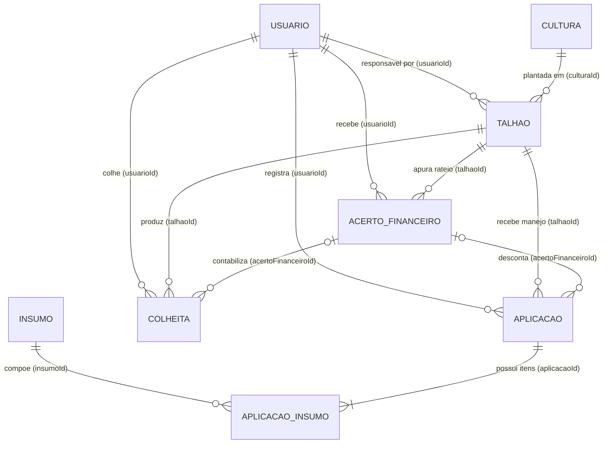
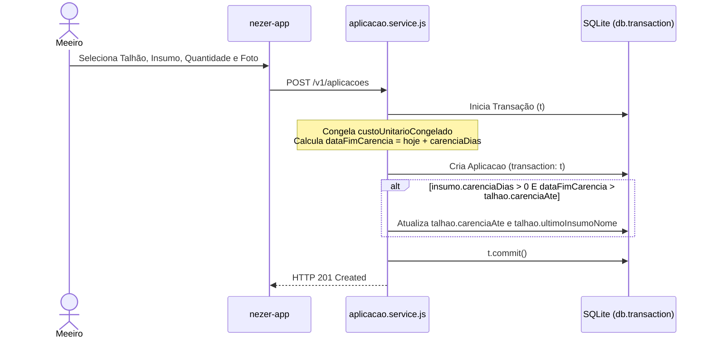

# 5. Arquitetura de Dados, Rotas da API e Glossário — Nezer Agro

> **O que é este documento e como ele facilita a compreensão do código?**
> Este arquivo reúne em um só lugar as documentações complementares de alto valor para o TCC: o **DER (Modelo Entidade-Relacionamento)**, o **Dicionário de Dados**, o **Catálogo de Endpoints REST**, os **Diagramas de Sequência** e o **Glossário Agronômico e Jurídico**.

---

## 5.1. Modelo Entidade-Relacionamento (DER)

---

## 5.2. Catálogo de Endpoints da API REST (`/v1/*`)

| Módulo | Rota | Permissão | Descrição |
| :--- | :--- | :---: | :--- |
| **Auth** | `POST /v1/auth/login` / `refresh` / `logout` | Pública / Logado | Login JWT, renovação de sessão e logout na `LogoutList`. |
| **Usuários** | `GET`, `POST`, `PUT`, `DELETE /v1/usuarios` | Admin | Gestão de meeiros e ativação/desativação (`ativo`). |
| **Culturas** | `GET /v1/culturas` \| `POST`, `PUT`, `DELETE` | Logado \| Admin | Cadastro de culturas e preços (`Mercado`, `Atacado`, `Polpa`). |
| **Insumos** | `GET /v1/insumos` \| `POST`, `PUT`, `DELETE` | Logado \| Admin | Cadastro de insumos, custo unitário e `carenciaDias`. |
| **Talhões** | `GET /v1/talhoes` \| `POST`, `PUT`, `DELETE` | Logado \| Admin | Quadras de plantio, `percentualMeeiro` e status de carência. |
| **Aplicações** | `GET`, `POST /v1/aplicacoes` | Logado | Registro de aplicação com foto, custo congelado e atualização de carência. |
| **Colheitas** | `GET`, `POST /v1/colheitas` \| `PATCH /:id/conferir` | Logado \| Admin | Registro de colheita com Termo de Ciência e conferência pelo Admin. |
| **Acertos** | `GET /v1/acertos` \| `POST` \| `PATCH /:id/pagar` | Logado \| Admin | Fechamento do Acerto a Meia (7 dias ou > R$ 10k) e anexo PIX. |
| **Relatórios** | `GET /v1/relatorios/dashboard` | Logado | Indicadores consolidados para os cards do Dashboard. |

---

## 5.3. Diagramas de Sequência das Transações Críticas

---

## 5.4. Glossário Agronômico e Jurídico (Estatuto da Terra & ANVISA)

* **INC nº 02/2018 (MAPA/ANVISA):** Norma que obriga a rastreabilidade de frutas e hortaliças frescas por lote/talhão.
* **Período de Carência (`carenciaDias` / `carenciaAte`):** Intervalo mínimo de dias entre a última aplicação de defensivo e a colheita para respeitar o Limite Máximo de Resíduo (LMR).
* **Vocabulário Jurídico (Estatuto da Terra — Lei nº 4.504/1964):**
  * Usar **Meeiro / Parceiro Agrícola** (nunca "Funcionário/CLT");
  * Usar **Demonstrativo de Rateio da Parceria ("Acerto a Meia")** (nunca "Holerite");
  * Usar **Evidência de Rastreabilidade do Manejo** (nunca "Controle de Ponto").
