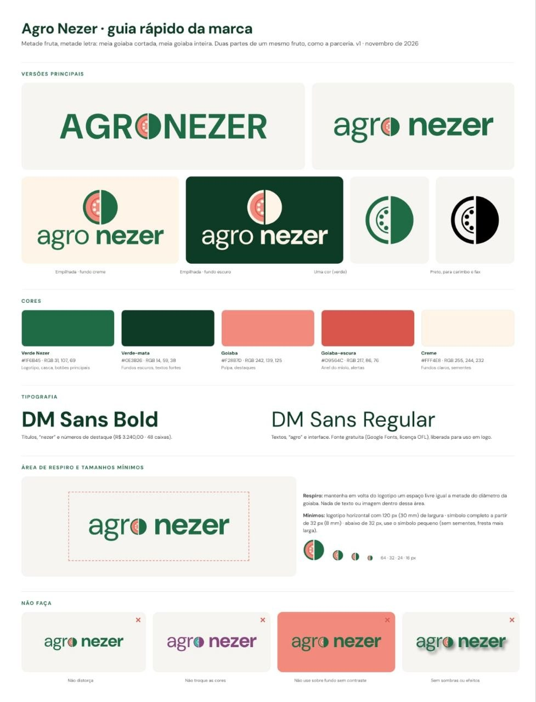
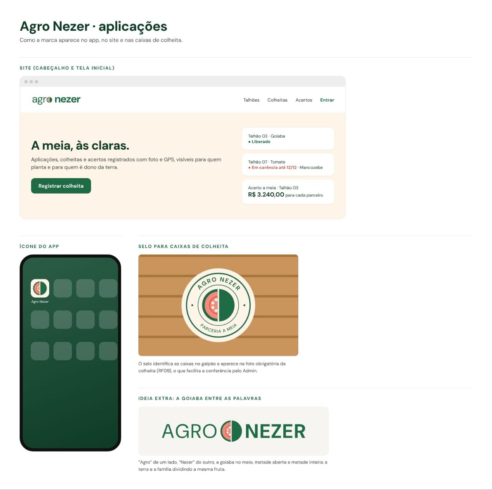
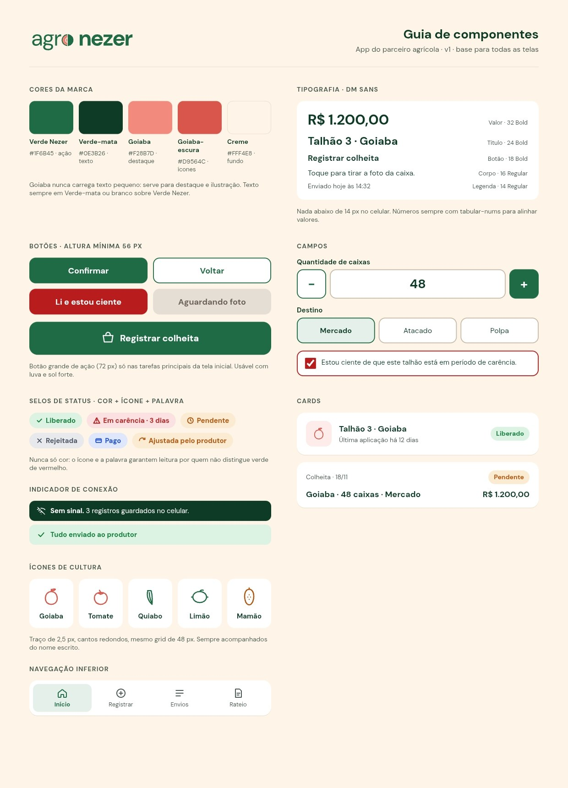
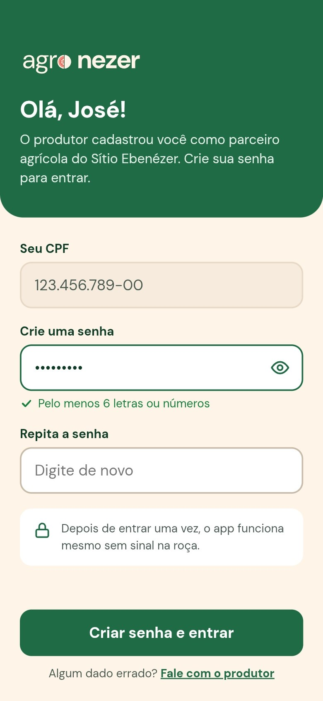
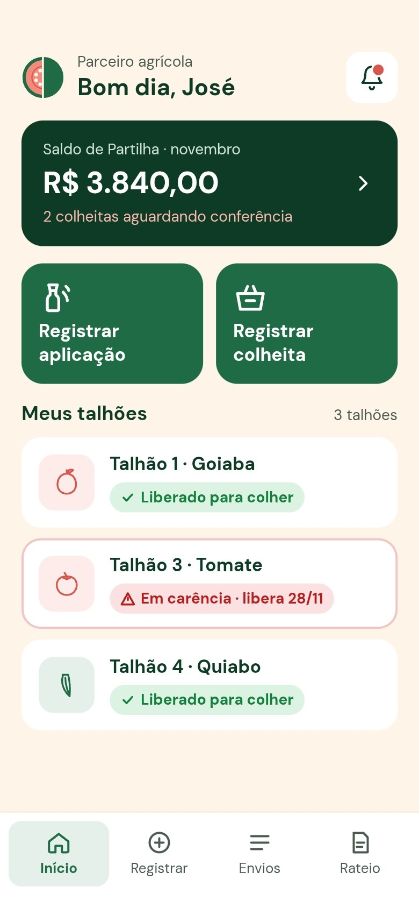
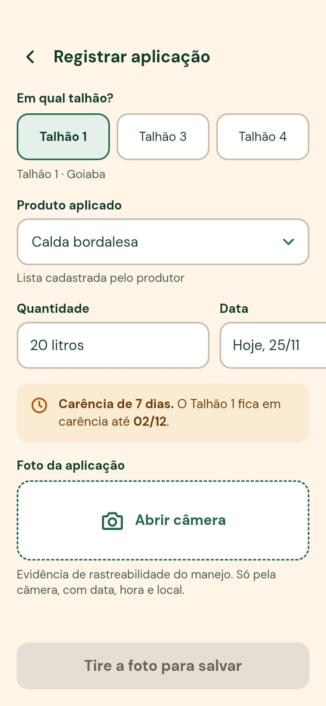
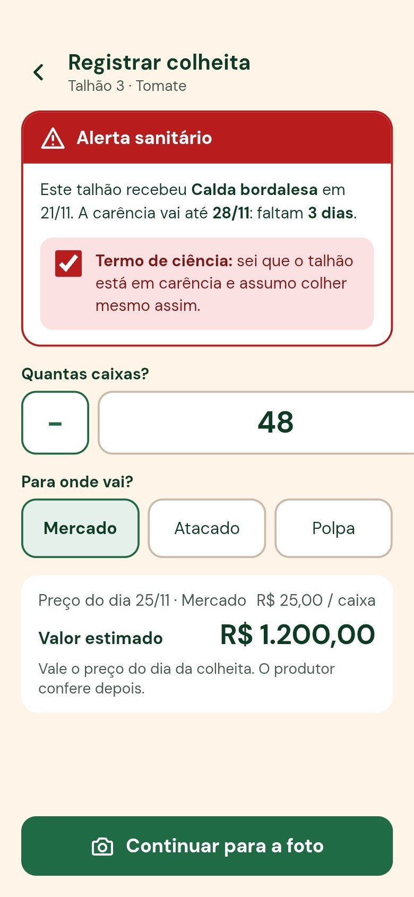
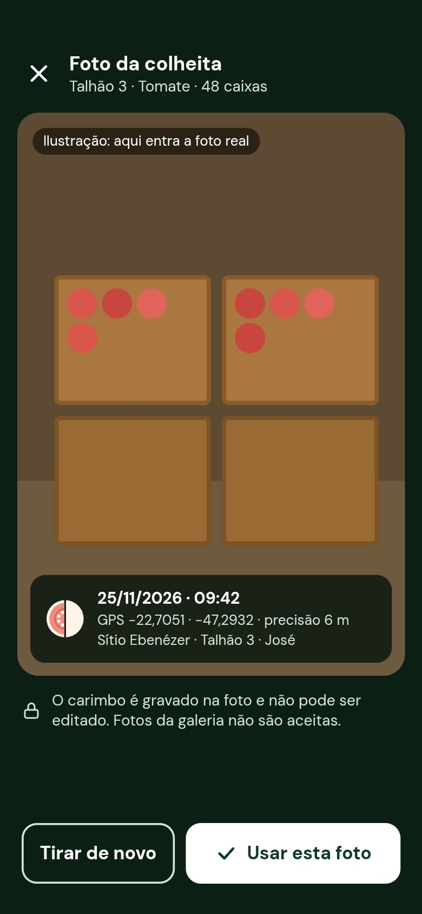
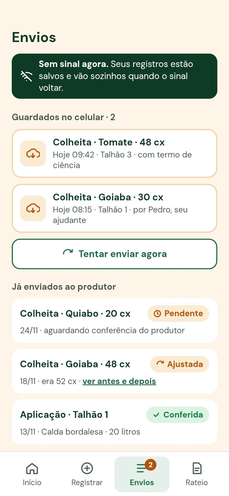
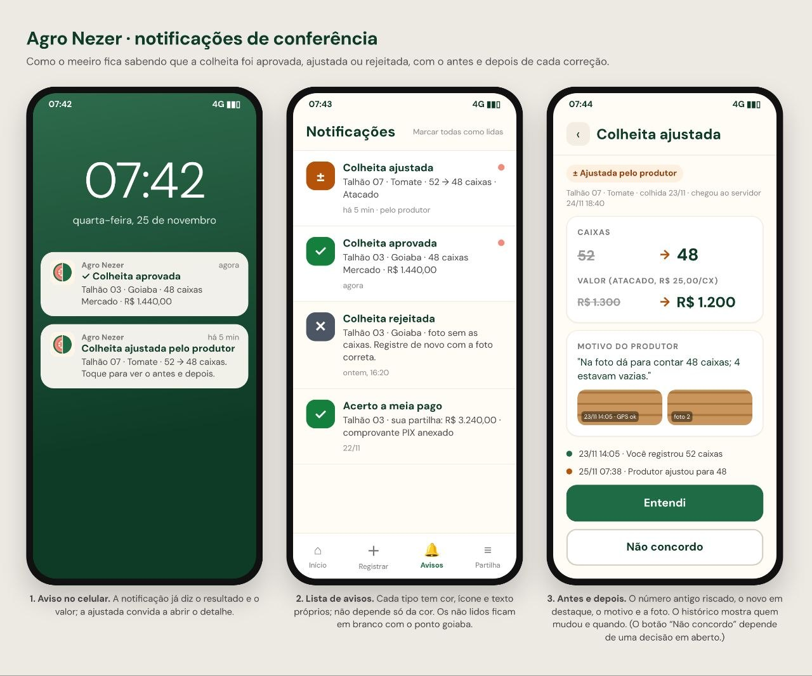

# 6. Design, Identidade Visual, Brief e Guia de Componentes — Agro Nezer

> **⚠️ Nota sobre o estágio do Design (Conceito Inicial):**
> Este material apresenta o **design conceito inicial (v2)** do projeto **Agro Nezer**. Ele serve como base visual e funcional para o desenvolvimento do MVP, **não é definitivo** e poderá sofrer ajustes, refinamentos e melhorias ao longo da construção do sistema.

> **O que é este documento?**
> Aqui estão reunidos o **Brief oficial do produto**, o **Guia Rápido da Marca**, as **Aplicações Visuais** (app, site e caixas de colheita como implementação futura), o **Guia de Componentes**, o fluxo de **Notificações** e as **Telas Conceituais do Usuário**.

---

## Sumário Rápido (Clique para ir direto ao trecho)
- [6.1. Visão Geral do Produto e Propósito da Marca](#6-1-visao-geral)
- [6.2. Públicos, Perfis e Contexto de Campo](#6-2-publicos-perfis)
- [6.3. Personalidade, Tom de Voz e Vocabulário Seguro](#6-3-tom-de-voz)
- [6.4. Identidade Visual, Guia Rápido da Marca e Aplicações](#6-4-identidade-visual)
- [6.5. Guia de Componentes UI (Design System)](#6-5-guia-componentes)
- [6.6. Telas Conceituais do Usuário e Notificações](#6-6-telas-usuario)
- [6.7. Fluxos Críticos, UX de Campo e Requisitos de Design](#6-7-fluxos-ux)
- [6.8. Decisões Tomadas e Matriz de Riscos](#6-8-decisoes-riscos)

---

## 6.1. Visão Geral do Produto e Propósito da Marca

O **Agro Nezer** é um app web *mobile-first* e *offline-first* que tira do caderno a parceria "a meia" entre produtor e meeiro: controla a carência dos defensivos e calcula o acerto financeiro com prova de foto e GPS.

* **Público inicial:** Pequenas e médias propriedades de multicultura (**goiaba, tomate, quiabo, limão e mamão**), começando pelo **Sítio Ebenézer**, da própria família.
* **As duas dores que o sistema resolve:**
  1. **Risco sanitário:** Colher dentro do prazo de carência e vender alimento com resíduo de defensivo.
  2. **Insegurança no acerto a meia:** Erro de conta, desconfiança e atrito na divisão de receitas e custos de insumo.
* **Promessa da marca:** *a meia, às claras* — tudo o que entra e sai do talhão fica visível para quem planta e para quem é dono da terra.
* **Origem do nome:** *"Nezer"* é a abreviação de **Ebenézer**, o nome do sítio da família. **"Agro Nezer"** une o campo e essa história.
* **Estágio atual:** TCC de Análise e Desenvolvimento de Sistemas (fundador único com vivência na rotina agrícola da família), projetado para atender à banca acadêmica e ao uso real no campo.

---

## 6.2. Públicos, Perfis e Contexto de Campo

| Perfil | Quem é | Onde usa | O que mais importa |
| :--- | :--- | :--- | :--- |
| **Admin** | Produtor, dono da terra e gestor da parceria | Celular e computador do escritório | Conferir colheitas pela foto, controlar a carência, corrigir registros em até 48h, fechar acertos sem erro |
| **Meeiro responsável** | Parceiro agrícola autônomo, 100% responsável pelos próprios talhões | Celular no talhão, muitas vezes sem sinal | Registrar aplicação e colheita em poucos toques e entender o rateio |
| **Ajudante** | Pessoa indicada pelo meeiro, com acesso aos talhões dele | Celular no talhão | Registrar aplicações e colheitas; não vê nem mexe no acerto financeiro |

* **Condições de uso no campo:** Sol forte na tela, mãos sujas ou com luva, celulares de entrada com pouca memória, sinal intermitente e pouca familiaridade com sistemas.
* **Primeiro acesso do Meeiro:** O Admin pré-cadastra e o Meeiro valida o cadastro criando a própria senha.

---

## 6.3. Personalidade, Tom de Voz e Vocabulário Seguro

A marca soa como um contador de confiança que conhece a roça: **justa, transparente, confiável, prática, do campo e moderna**.

* **Botões curtos no imperativo:** `"Registrar colheita"`, `"Aprovar"`, `"Anexar PIX"`.
* **Alertas firmes, sem alarde:** `"Talhão em carência até 12/12 — último insumo: Mancozebe"`.
* **Números sempre com unidade e moeda:** `"48 caixas"`, `"R$ 3.240,00"`.
* **Erros que orientam:** `"Sem sinal. A colheita foi salva e será enviada quando a internet voltar."`

### Vocabulário da Parceria (Estatuto da Terra — RNF06)

| Usar (termo seguro) | Nunca usar | Por quê |
| :--- | :--- | :--- |
| **Parceiro agrícola, meeiro** | Funcionário, trabalhador, empregado | Sugere vínculo de emprego (CLT) |
| **Demonstrativo de Rateio da Parceria** | Holerite digital, folha, contracheque | Documentos trabalhistas (CLT) |
| **Saldo de Partilha do Parceiro** | Salário líquido, pagamento | A receita é dividida, não paga |
| **Evidência de Rastreabilidade do Manejo** | Prova de trabalho, ponto | Soa como controle de subordinação |
| **Alerta Sanitário com Termo de Ciência** | Trava punitiva, bloqueio | Protege o alimento sem punir o parceiro |
| **Talhão** | Setor, área de trabalho | Termo do campo e da rastreabilidade (INC 02/2018) |

---

## 6.4. Identidade Visual, Guia Rápido da Marca e Aplicações

A logo é **"metade fruta, metade letra"**: no lugar do **O**, meia goiaba cortada (polpa e sementes) e meia fruta inteira verde (que também remete ao limão) — duas metades de um mesmo fruto, como a parceria.

### Guia Rápido da Marca

### Aplicações da Marca (App, Site e Caixas de Colheita — Implementação Futura)
> *Nota: A aplicação da marca nas caixas físicas de colheita é uma visão de **implementação futura** pós-MVP.*

### Paleta de Cores da Marca

| Nome | HEX | Uso |
| :--- | :---: | :--- |
| **Verde Nezer** | `#1F6B45` | Logotipo, botões principais, metade inteira do fruto |
| **Verde-mata** | `#0E3B26` | Fundos escuros, textos de destaque |
| **Goiaba** | `#F28B7D` | Polpa, destaques suaves, ilustrações |
| **Goiaba-escura** | `#D9564C` | Anel do miolo, detalhes da marca |
| **Creme** | `#FFF4E8` | Fundos claros, sementes |

### Cores de Status (Separadas da Marca — Sempre com Ícone + Texto)

| Status | Cor | Ícone e Texto |
| :--- | :---: | :--- |
| **Liberado** | Verde `#15803D` | ✓ `"Liberado"` |
| **Em carência** | Vermelho `#B91C1C` | ⚠ `"Em carência até DD/MM"` + último insumo |
| **Pendente de conferência** | Âmbar `#B45309` | ⏳ `"Aguardando conferência"` |
| **Rejeitada** | Cinza-escuro `#4B5563` | ✕ `"Rejeitada"` + motivo |
| **Pago** | Azul `#1D4ED8` | ✓ `"Pago via PIX"` |

* **Tipografia:** **DM Sans** (Google Fonts) — Bold para títulos/valores, Regular para textos. Mínimo `16px` no celular e `24px+` nos valores do acerto.
* **Ícones:** Traço único e cantos arredondados (**Lucide**), com ícones próprios para goiaba, limão, tomate, quiabo, caixa de colheita e talhão.

---

## 6.5. Guia de Componentes UI (Design System)

---

## 6.6. Telas Conceituais do Usuário e Notificações

> **Lembrete:** Estas telas representam o **conceito visual inicial** dos principais fluxos do usuário no celular e podem evoluir durante a implementação do `nezer-app`.

### 6.6.1. Primeiro Acesso e Tela Inicial
| Login e Criação de Senha (Primeiro Acesso) | Tela Inicial do Usuário |
| :---: | :---: |
|  |  |

### 6.6.2. Fluxos de Campo (Aplicação, Colheita, Câmera e Fila Offline)
| Registro de Aplicação | Registro de Colheita |
| :---: | :---: |
|  |  |

| Foto da Colheita (Câmera + Carimbo GPS/Hora) | Fila de Envios e Sincronização Offline |
| :---: | :---: |
|  |  |

### 6.6.3. Notificações de Conferência (Aprovada, Ajustada com Antes/Depois e Rejeitada)

---

## 6.7. Fluxos Críticos, UX de Campo e Requisitos de Design

* **Alvos de toque grandes:** Botões com pelo menos `56px` de altura e ação principal fixa na base da tela, ao alcance do polegar.
* **Alto contraste:** Contraste mínimo `7:1` (nível AAA) nas telas de campo para uso sob sol forte.
* **Poucos passos:** Registrar uma colheita em até 5 toques e 1 foto; lembrar último talhão e destino usados.
* **Offline visível:** Indicador fixo (`"Sem sinal · 3 registros na fila"`), estado individual por registro e botão `"Enviar agora"`.
* **Foto direto da câmera:** `capture="environment"` sem acesso à galeria, com compressão antes de salvar e carimbo de data, hora e GPS gerados pelo app.
* **Critérios de sucesso:** Um meeiro sem treino registra uma colheita sozinho em menos de 1 minuto; o Admin fecha um acerto em menos de 5 minutos; nenhuma colheita em carência passa sem alerta.

---

## 6.8. Decisões Tomadas e Matriz de Riscos

### Decisões Consolidadas
| Tema | Decisão | Impacto no Sistema / Design |
| :--- | :--- | :--- |
| **Nome e Marca** | Agro Nezer (abreviação de Ebenézer) | Usado em telas, monografia e repositório |
| **Preços por Cultura** | Mercado, Atacado e Polpa com `"vale a partir de"` e histórico | Vale o preço da **data da colheita** (meeiro vê, nunca digita) |
| **Equipe do Talhão** | 1 Meeiro Responsável + Ajudantes vinculados | `"Ajudante de [nome]"` só registra; não entra no acerto |
| **Acesso por Talhão** | Meeiro/Ajudante só vê os próprios talhões | Listas filtradas por usuário |
| **Correção pelo Admin** | Só o Admin corrige em até **48h** após chegada ao servidor | Contador visível; meeiro vê o antes/depois nas notificações |
| **Demonstrativo** | Exibido na tela do celular (sem PDF no MVP) | Layout limpo pensado para leitura no mobile |

### Principais Riscos Mapeados
* **Resistência do meeiro (sensação de vigilância):** Mitigado mostrando primeiro o benefício dele (quanto vai receber e demonstrativo transparente).
* **Burla de foto:** Mitigado exigindo câmera ao vivo (sem galeria) + carimbo de data/hora/GPS + conferência do Admin.
* **Conflito offline e espaço no celular:** Mitigado com compressão de imagem, aviso de `"atualizado em DD/MM às HH:MM"` e limpeza automática após envio.
